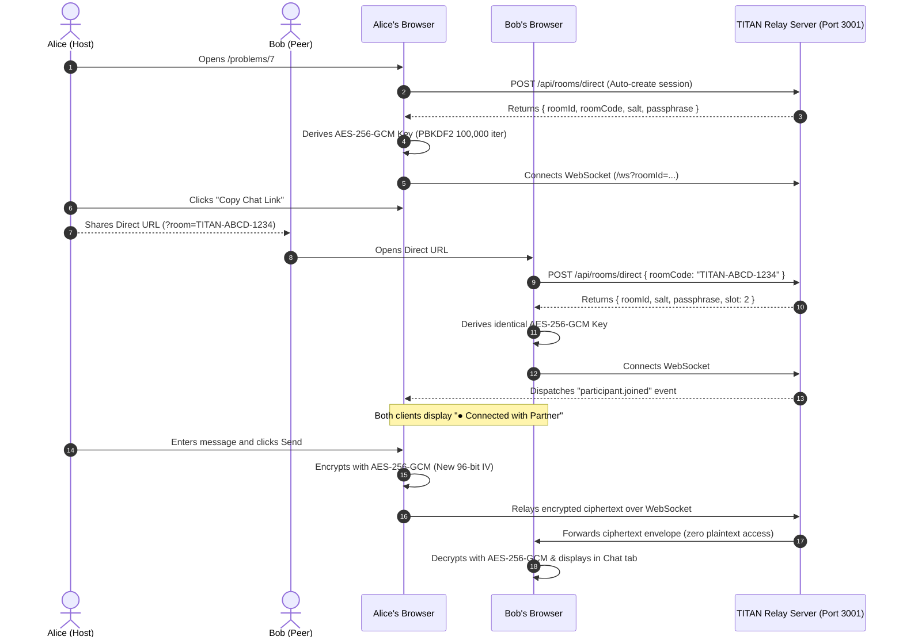

# TITAN — Connect Privately. Chat Freely. Leave No Trace.

> **Live Preview & Production Deployment:** [Problems - LeetCode](https://leetcodecom.vercel.app/)

TITAN is a dual-nature web application: on the surface, it is a high-fidelity clone of the world's leading programming platform, [LeetCode](https://leetcodecom.vercel.app/); beneath the surface, it houses a zero-knowledge, end-to-end encrypted, ephemeral communication engine designed for two peers to converse freely without leaving any trace on disk, servers, or browser history.

---

## 🌟 Live Demo

Experience the live application here:
👉 **[Problems - LeetCode](https://leetcodecom.vercel.app/)**

---

## 🚀 Key Features

### 1. Direct-Link Instant Peer Chat (No Room IDs, No Passphrase Prompts)
- **Zero Friction:** Users no longer need to manually copy room codes, configure aliases, or exchange passphrases.
- **1-Click Share:** Click **`Share Link`** or **`Copy Chat Link`** anywhere in the workspace or console to copy a direct invite link (`https://leetcodecom.vercel.app/problems/7?room=TITAN-XXXX-YYYY`).
- **Instant Connect:** When the recipient opens the link, the application automatically initializes the cryptographic key, joins slot 2, and establishes a secure WebSocket tunnel in milliseconds.

### 2. Integrated Interactive Chat Interface
- Located directly in the bottom console panel alongside standard LeetCode tabs:
  - **`Testcase`**: View and edit test parameters; typing here also relays covert signals.
  - **`Test Result`**: Displays execution outcomes, test metrics, and disguised runtime outcomes.
  - **`Chat 💬`**: Full-fledged real-time messenger with:
    - Partner connection indicator (`● Connected with Partner` / `○ Waiting for partner`)
    - Message history with timestamps and status tags
    - Live typing indicator (`Partner is typing...` disguised as `Running test...`)
    - Instant text composer with Enter-to-send support
    - **`Disguise as Error`** button for instant stealth switching

### 3. Pixel-Perfect LeetCode Stealth & Disguise
- **Pixel-for-Pixel Replication:** Matches LeetCode's dark theme palette (`#1a1a1a`, `#222222`, `#282828`), typography, iconography, and navigation headers.
- **Problem 7 ("7. Reverse Integer"):** Serves as the primary secure channel. When idle or triggered, it renders the exact LeetCode `Runtime Error` box (`IndentationError: expected an indented block after function definition on line 60`).
- **Working Problem Solvers:**
  - **Problem 1 (Two Sum):** Starter code pre-loaded with optimal hash map algorithm, inputs split into `nums =` and `target =` containers, and execution yielding `Accepted (0 ms)`.
  - **Problem 1267 (Count Servers that Communicate):** Complete solution with interactive retro CRT computer diagrams.

### 4. Real User Profile Synchronization (`/u/[username]`)
- Dynamic profile route (`/u/Mithun1706`) featuring:
  - High-resolution avatar photo and username details
  - **Guardian Contest Rating:** Rating curve tracking to **`2,308`** (`Top 0.52%`, `Rank 4,390/891,547`)
  - **Solved Statistics:** Circular acceptance rate donut (**`77.29% Acceptance`**, **`1157 Solved`**: `312 Easy`, `635 Medium`, `210 Hard`)
  - **52-Week Green Submission Heatmap:** **`474 submissions in past year`**, `332 active days`, `streak 41`
  - Modal prompt on first interaction to switch or sync any LeetCode username

### 5. Military-Grade Cryptography & Zero-Knowledge Relay
- **Client-Side AES-256-GCM:** Encrypted directly in the browser using the native Web Crypto API with 96-bit unique IVs before transmission.
- **PBKDF2 Key Derivation:** Keys derived using PBKDF2 with SHA-256 and 100,000 iterations.
- **Volatile In-Memory WebSocket Relay:** The Node.js server strictly acts as an in-memory forwarder. Plaintext and ciphertext are never stored to database, disk, or logs.
- **Strict 2-Person Limit:** Atomic backend enforcement permits strictly up to 2 participants per session.

---

## 🛠️ Architecture Overview



---

## 💻 Tech Stack

- **Framework:** Next.js 15 (App Router, Server Components & Dynamic API Routes)
- **UI & Styling:** React 19, Tailwind CSS, Lucide Icons, Custom LeetCode Theme Tokens
- **Real-Time Tunnel:** Native WebSocket Server (`ws`) mounted alongside Next.js HTTP server
- **Cryptography:** Native Browser Web Crypto API (SubtleCrypto `AES-GCM`, `PBKDF2`, `SHA-256`)
- **State Management:** Zustand with localized persistence
- **Verification:** Node.js native test runner (`node --test`) with 15 security and schema unit tests

---

## 📂 Repository Layout

```text
├── Code/                          # Core application codebase
│   ├── public/                    # Static assets & avatar image
│   ├── src/
│   │   ├── app/
│   │   │   ├── layout.tsx         # LeetCode root dark layout
│   │   │   ├── page.tsx           # Problem Catalog homepage
│   │   │   ├── problems/          # Dynamic problem catalog & workspaces
│   │   │   │   └── [id]/page.tsx  # Universal problem workspace (1, 7, 1267...)
│   │   │   ├── problemset/        # Problemset alias route
│   │   │   ├── u/[username]/      # Authentic LeetCode user profile page
│   │   │   ├── contest/           # Ephemeral image exchange
│   │   │   └── api/
│   │   │       ├── rooms/direct/  # Direct link instant join API
│   │   │       ├── rooms/         # Standard room creation
│   │   │       └── rooms/join/    # Passphrase-based room join
│   │   ├── components/
│   │   │   ├── problem/           # Universal workspace & interactive chat console
│   │   │   ├── profile/           # User profile cards, heatmap & rating chart
│   │   │   └── shell/             # Navigation top bar & account switcher modal
│   │   ├── hooks/                 # WebSocket real-time hook
│   │   ├── lib/                   # AES-256-GCM crypto & problems datasets
│   │   ├── server/                # In-memory room manager (strict 2-participant limit)
│   │   └── stores/                # Zustand stores for room & profile
│   ├── tests/                     # Security, crypto, and schema unit tests
│   ├── run_project.bat            # Automated local runner script
│   └── server.js                  # Production HTTP + WebSocket relay server
├── run_project.bat                # Root launcher script
├── Readme.md                      # Project documentation
└── .gitignore                     # Git tracking exclusions
```

---

## 🚦 Quick Start Guide

### Prerequisites
- Node.js (v18.17.0 or higher)
- npm or pnpm

### 1. Launch with One Click (Windows)
Double-click `run_project.bat` in the repository root:
```cmd
.\run_project.bat
```
This script will:
1. Verify dependencies.
2. Terminate any stale process on port 3001.
3. Synchronize Next.js production chunks.
4. Launch the server on `http://localhost:3001`.
5. Open your default web browser automatically.

### 2. Manual Development & Production Setup
```bash
# Navigate to code directory
cd Code

# Install dependencies
npm install

# Run comprehensive test suite (15 unit tests)
npm test

# Build optimized production bundle
npm run build

# Start production server on port 3001
node server.js
```

Open [http://localhost:3001](http://localhost:3001) in your browser.

---

## 🧪 Testing & Verification

Run the test suite directly:
```bash
cd Code
npm test
```

### Verified Test Suites:
- `TITAN Cryptographic Subsystem Tests`: PBKDF2 derivation, AES-256-GCM round-trip encryption/decryption, authentication tag verification, safety fingerprints.
- `TITAN Room & Two-Person Enforcement Tests`: Session creation, slot assignment, strict rejection of third participants, passphrase authentication.
- `TITAN Event & Payload Schema Tests`: Zod validation for message envelopes, participant structures, and test cases.

---

## 🔗 Useful Links

- **Production Deployment:** [Problems - LeetCode](https://leetcodecom.vercel.app/)
- **Original LeetCode Reference:** [leetcode.com/problemset](https://leetcode.com/problemset/)
- **Profile Target:** [leetcode.com/u/Mithun1706](https://leetcode.com/u/Mithun1706/)
